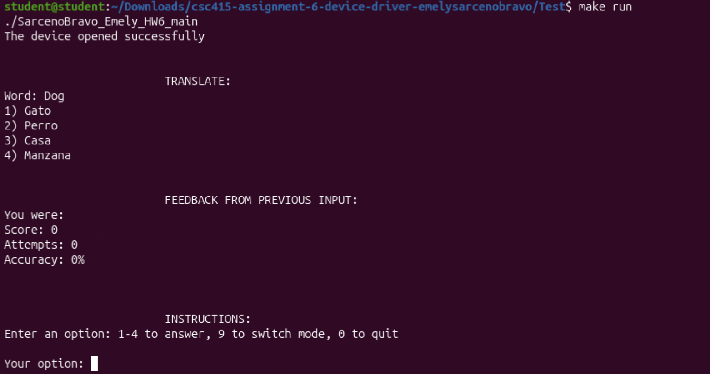
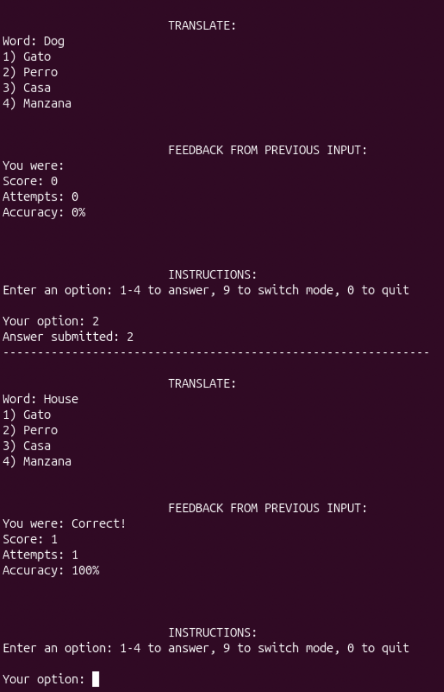
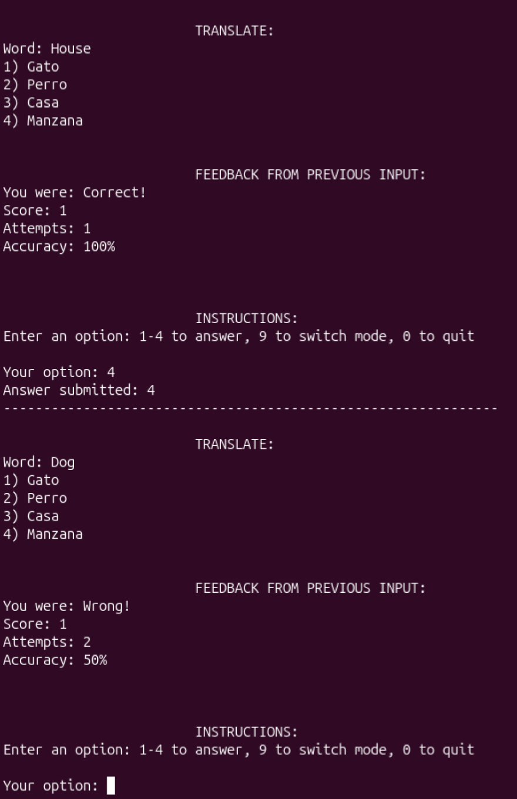
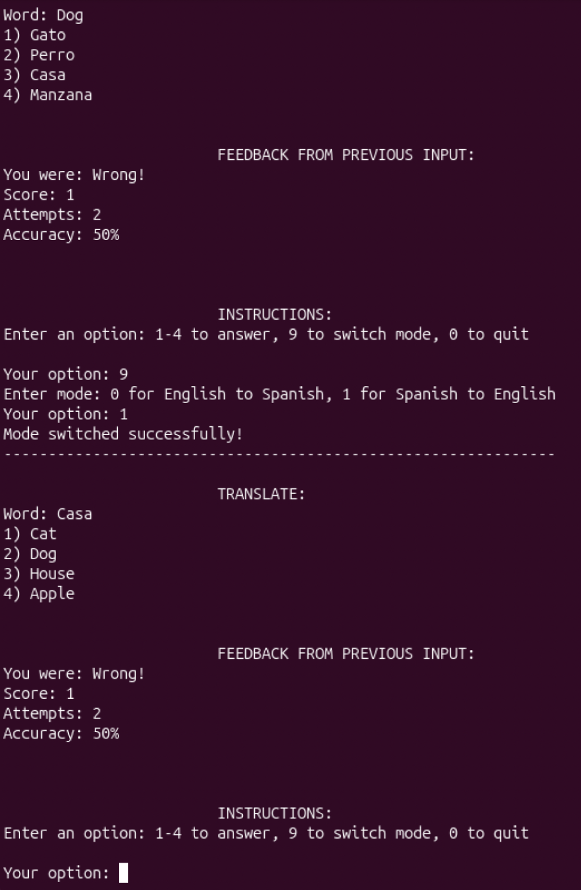
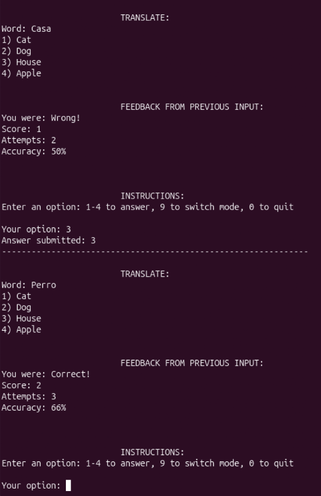
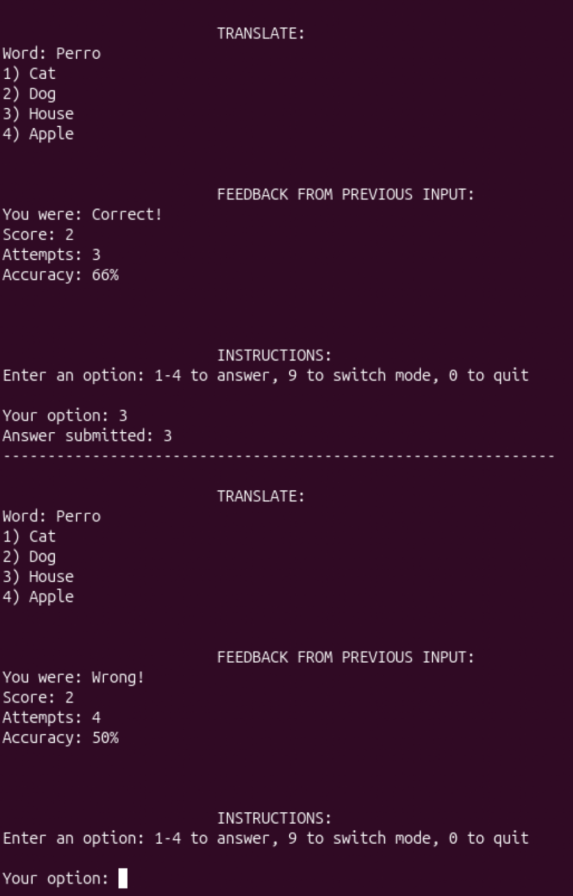
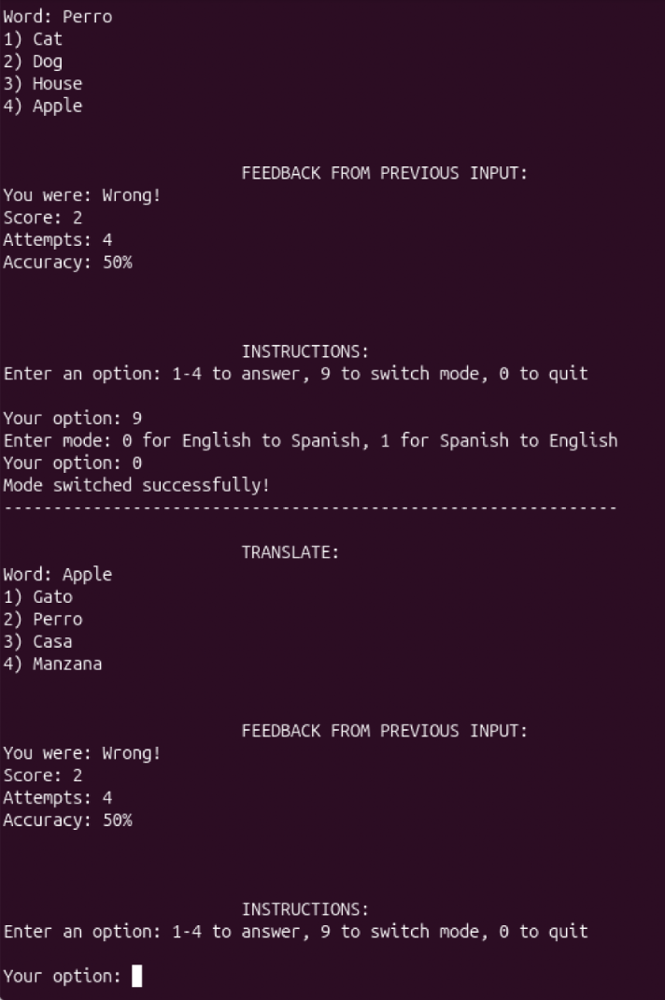
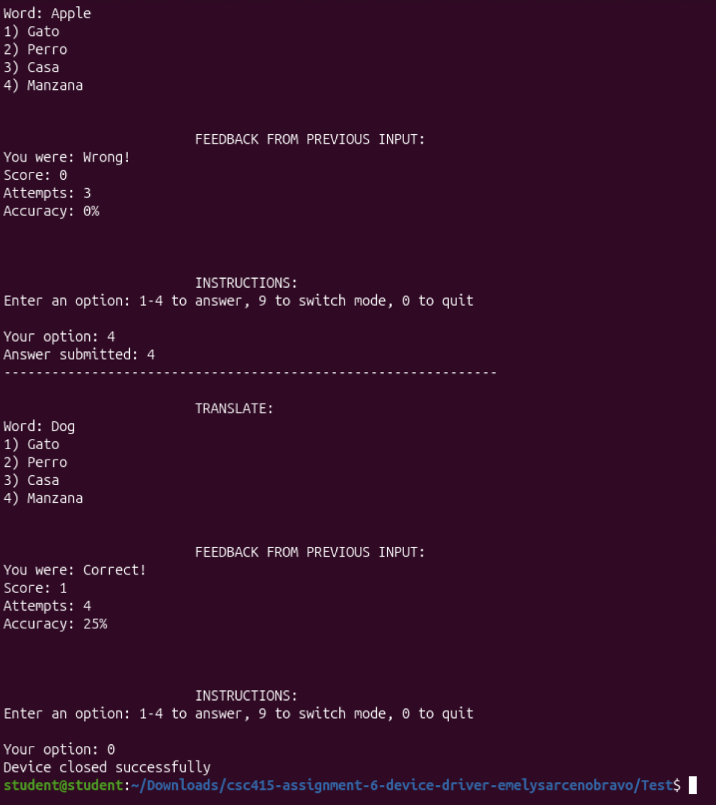
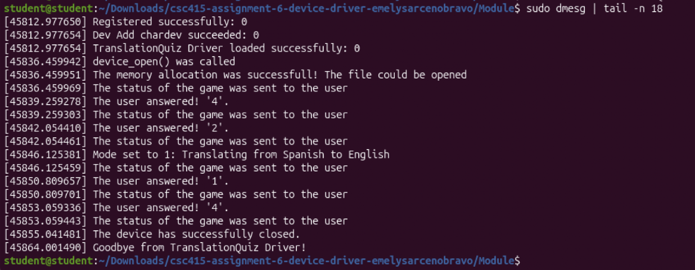

# TranslationQuiz Driver

A Linux character device driver, written in C, that turns the kernel into a Spanish teacher. Inspired by Duolingo, it quizzes you on English–Spanish vocabulary through ordinary file operations: reading the device shows a question, writing to it submits your answer, and `ioctl` switches the translation direction.

Solo project for CSC 415 (Operating Systems) at San Francisco State University, Spring 2026.

> **About this repository:** The source code is kept private in line with course academic-integrity guidelines. This page is a showcase of the project.

## The idea

The assignment was to build a character device driver that talks to a user program through file operations like `read` and `write`. I wanted something people could actually use, so I built a small language-learning quiz:

- **Mode 0** asks you to translate a word from English to Spanish.
- **Mode 1** asks you to translate a word from Spanish to English.
- Each round gives four options. A correct answer raises your score and accuracy; a wrong one lowers your accuracy.

## A quick walkthrough

**1. Start the quiz.** The test program opens the device and reads the first question, along with your score and the instructions.



**2. Answer in English → Spanish mode.** Each answer is written to the device. The driver checks it, updates your score and accuracy, and sends back feedback with the next question.

<table>
  <tr>
    <td align="center" valign="top" width="50%">
      <br>
      <sub>A correct answer: score and accuracy go up.</sub>
    </td>
    <td align="center" valign="top" width="50%">
      <br>
      <sub>A wrong answer: accuracy drops.</sub>
    </td>
  </tr>
</table>

**3. Switch to Spanish → English.** Entering `9` asks which mode you want, and choosing `1` calls `ioctl` to flip the direction. The next question asks for the English translation of a Spanish word.



**4. Answer in Spanish → English mode.** Scoring works the same way in both directions.

<table>
  <tr>
    <td align="center" valign="top" width="50%">
      <br>
      <sub>“Casa” → House: correct.</sub>
    </td>
    <td align="center" valign="top" width="50%">
      <br>
      <sub>“Perro” → House: wrong.</sub>
    </td>
  </tr>
</table>

**5. Switch back.** Entering `9` and then `0` returns to English → Spanish, and your score carries over.



**6. Invalid input is rejected.** The driver only accepts `1`–`4` as answers, and the program only accepts `9` and `0` as commands. An out-of-range number, such as `7`, is treated as invalid instead of being counted as an answer, so it can't change your score or accuracy.

**7. Quit.** Entering `0` closes the device and ends the session.



**Behind the scenes,** the kernel log traces every step: registering the driver, opening the device, each answer and mode change, closing, and unloading.



## Setting it up

You'll need a Linux machine (I used Ubuntu) with the kernel headers installed.

```bash
# 1. Build the kernel module
cd Module
make                                   # produces TranslationQuiz.ko

# 2. Load it into the kernel
sudo insmod TranslationQuiz.ko

# 3. Create the device file and let your user read and write it
sudo mknod /dev/TranslationQuiz c 415 1
sudo chmod 666 /dev/TranslationQuiz

# 4. Build and run the test program
cd ../Test
make
make run                               # or ./TranslationQuiz

# 5. When you're done, unload the module
sudo rmmod TranslationQuiz
```

To watch the driver's log while you play, run `sudo dmesg | tail -n 20`.

**Controls:** `1`–`4` to answer, `9` to switch modes, `0` to quit.

## How it works

### The driver's file operations

The module registers a `file_operations` struct, so each system call on `/dev/TranslationQuiz` maps to a quiz action:

| Function | What it does |
|---|---|
| **Initialize** | Registers the character device with `register_chrdev_region()`, then initializes it and adds it to the kernel. |
| **Open** | Allocates a fresh quiz session and generates the first random question. |
| **Read** | Sends the current state of the game to the user: the question, the four options, feedback on the last answer, the score and the accuracy. |
| **Write** | Copies the user's answer into a kernel buffer, checks it, updates the score and accuracy, and generates the next question. |
| **ioctl** | Switches between English→Spanish (mode 0) and Spanish→English (mode 1). |
| **Close** | Frees the memory allocated for the session. |
| **Exit** | Unregisters the device with `unregister_chrdev_region()` and frees what was allocated at startup. |

### The quiz logic

On top of the file operations, the driver has its own helpers:

- **Word banks** for English and Spanish.
- **A random word picker** that chooses each round's question using the kernel's `random.h`.
- **An answer checker** that compares the user's choice with the correct translation.
- **An accuracy calculator** based on score and attempts.
- **Feedback** so the user can see whether their last choice was right.

### The test program

1. Opens the device file and checks that it succeeded.
2. Reads from the device to show the first question and the instructions.
3. Sends the user's answer. The driver rejects anything outside 1–4.
4. Reads again to get feedback and the next question.
5. Repeats until the user enters `0`, then closes the device file.

## What I learned

- **The kernel/user boundary is real.** You can't simply use a pointer from user space inside the kernel. `copy_to_user` and `copy_from_user` made me think about where every byte lives.
- **Validate everything in kernel code.** A bad input in an app throws an error; in a driver it can crash the system. Bounded buffers and strict parsing weren't optional.
- **Every allocation needs an owner.** Allocating on open and freeing on close taught me to plan cleanup as carefully as setup.

## Tech stack

C · Linux kernel modules · Character devices · ioctl · Makefile · Ubuntu · Git

## Links

- [Full case study on my portfolio](https://portfolio-emelysarcenobravo.vercel.app/work/translation-quiz)
