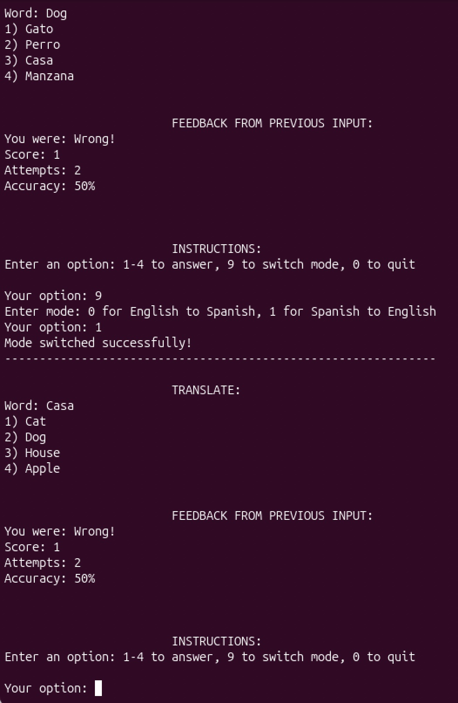
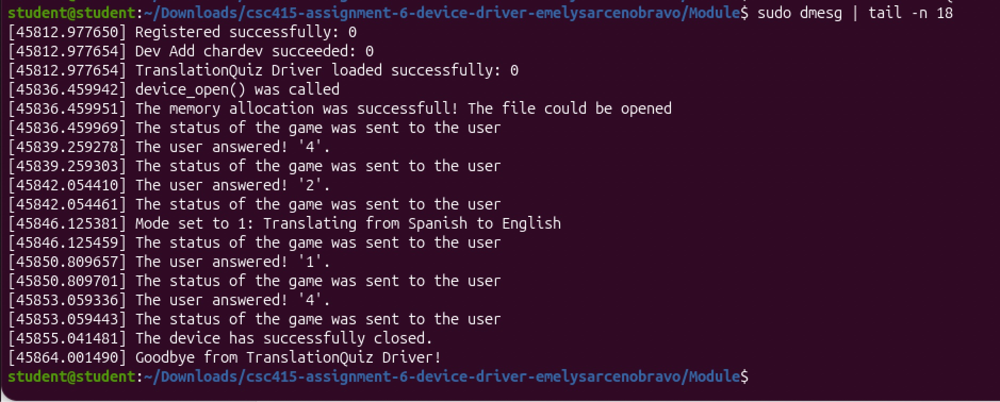

# TranslationQuiz Driver

A loadable Linux kernel module written in C that runs an English–Spanish vocabulary quiz. Reading the device shows a question and your score, writing to it submits an answer, and `ioctl` switches the translation direction. Solo project for CSC 415 (Operating Systems) at San Francisco State University, Spring 2026.

> **About this repository:** The source code is kept private in line with course academic-integrity guidelines. This page is a showcase of the project. Code is available on request.

## How it works

Each Linux file operation maps to a quiz action:

| Operation | What it does |
|---|---|
| `open` | Starts a new quiz session and generates the first question |
| `read` | Returns the current word, four options, feedback, score and accuracy |
| `write` | Submits an answer from 1 to 4 and generates the next question |
| `ioctl` | Switches between English→Spanish and Spanish→English |
| `release` | Frees the session's memory |

## What I built

- The character device driver: `open`, `release`, `read`, `write` and `ioctl`.
- A user-space test program with a menu to answer questions, switch modes and quit.
- A write-up documenting how to build, load, use and unload the driver.

## Highlights

- Moves data safely across the kernel/user boundary with `copy_to_user` and `copy_from_user`.
- Validates every answer with bounded buffers and `kstrtoint`, since bad input in kernel code can crash the system.
- Keeps each session's state in `private_data`, allocated on open and freed on release.

## Tech stack

C · Linux kernel modules · Character devices · ioctl · Makefile · Ubuntu · Git

## Links

- [Full case study on my portfolio](https://portfolio-emelysarcenobravo.vercel.app/work/translation-quiz)